# Ember on screen

Captures rendered from Ember's interface with representative sample media and app
artwork. Content, visible sources and effects depend on your setup and device.

## Home interfaces

| Ember | Ember Light |
| --- | --- |
| 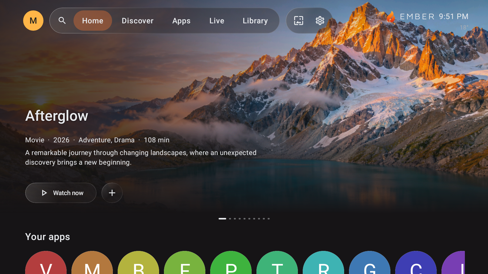 | 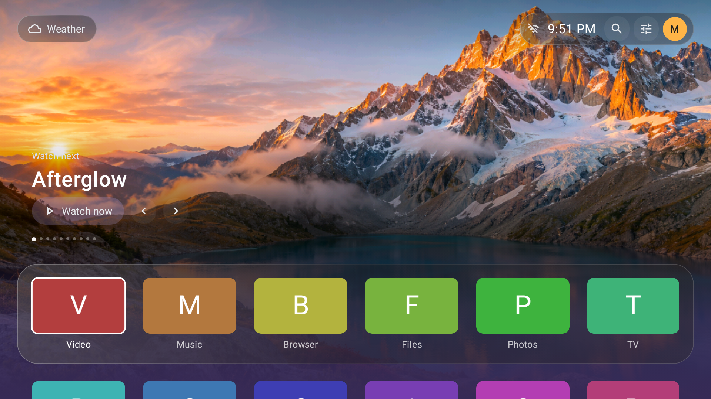 |

## Find something to watch

| Search | Discover |
| --- | --- |
| 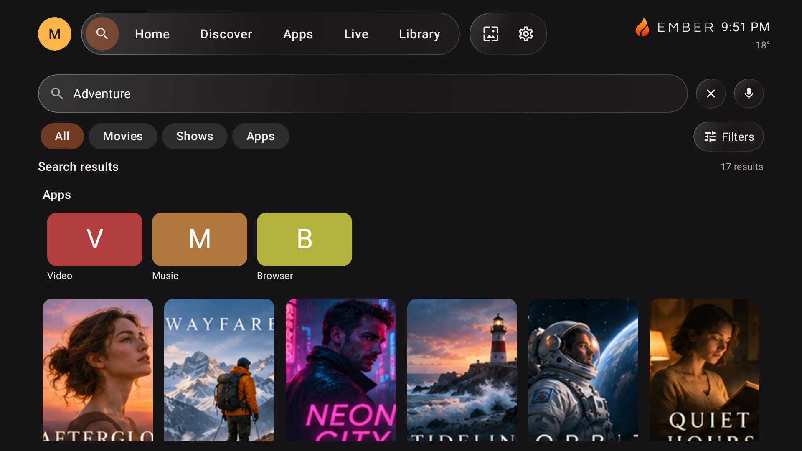 | 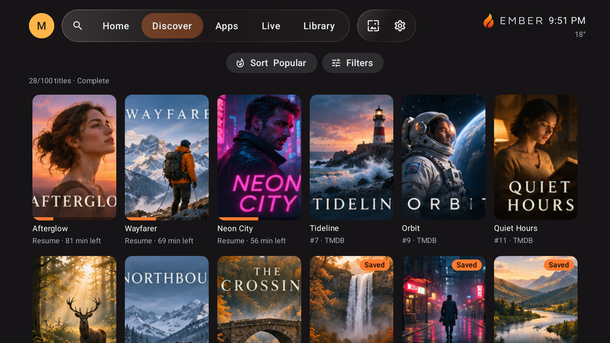 |

| Apps | Personal library |
| --- | --- |
| 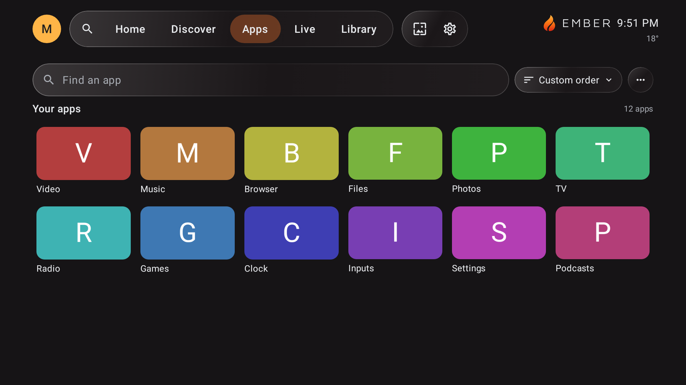 | 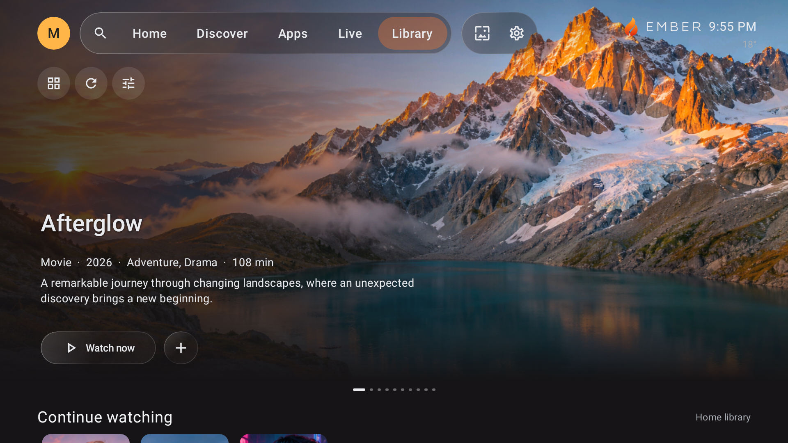 |

## Live TV

| Glass Guide | On Now Canvas |
| --- | --- |
| 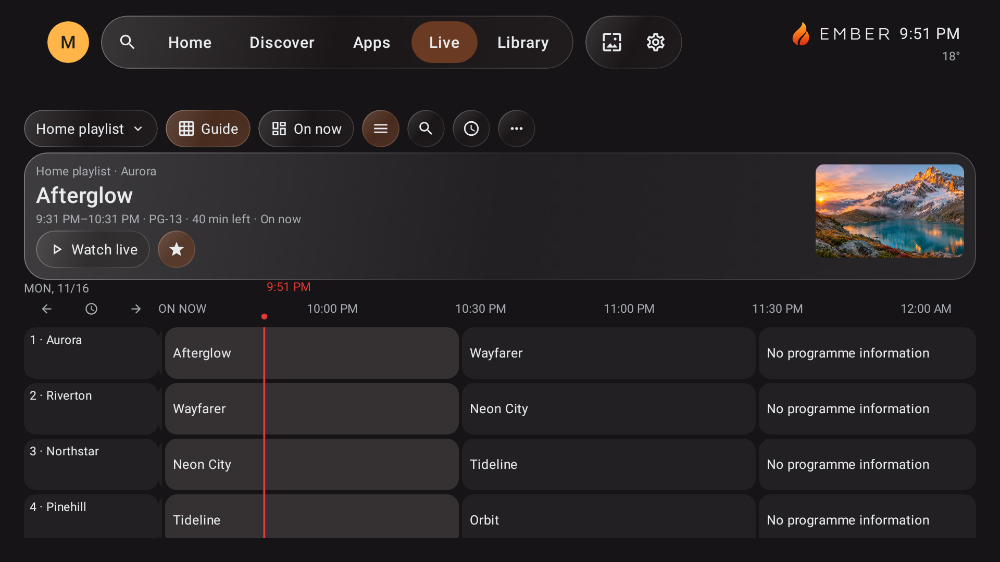 | 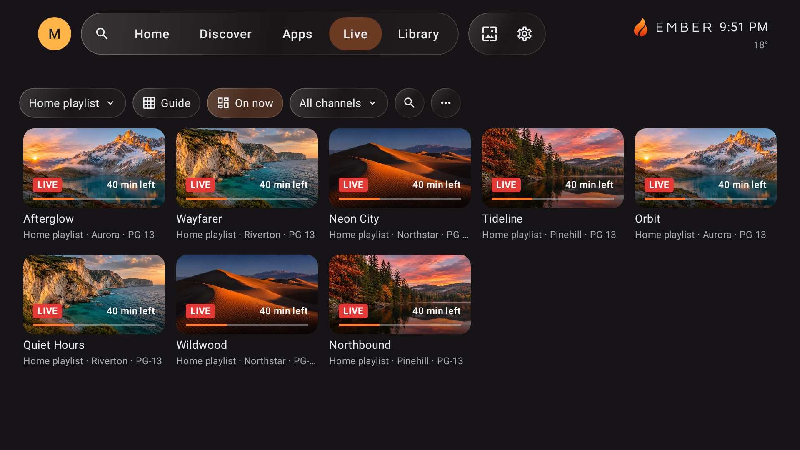 |

## Media-page layouts

| Ember | Ember X |
| --- | --- |
| 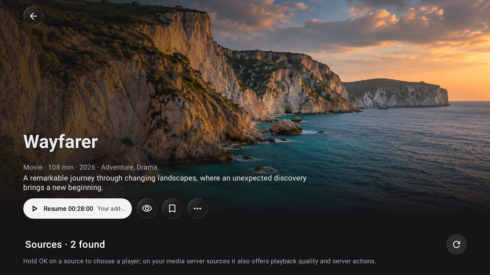 | 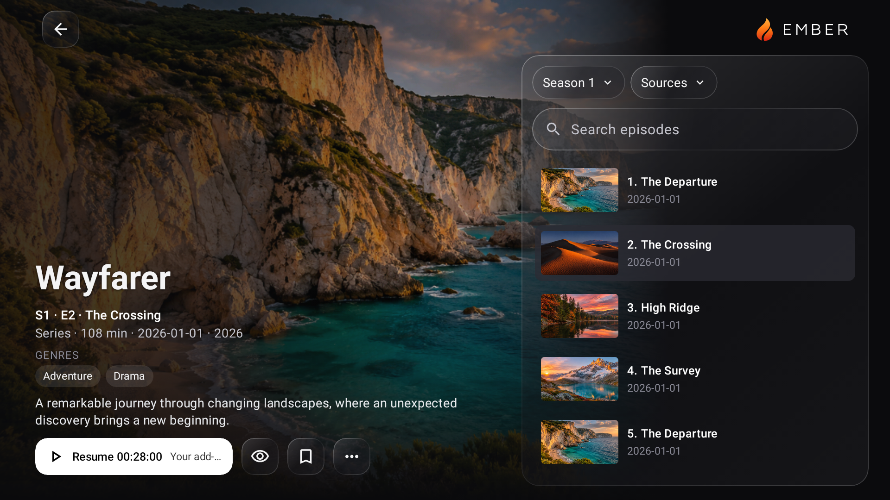 |

## Settings and quick controls

| Settings | Quick settings |
| --- | --- |
| 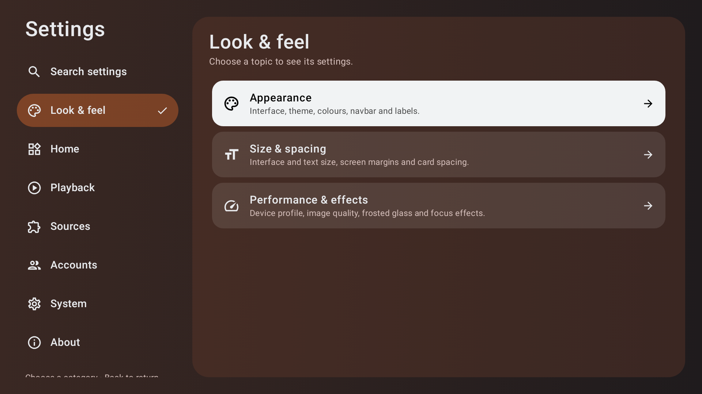 | 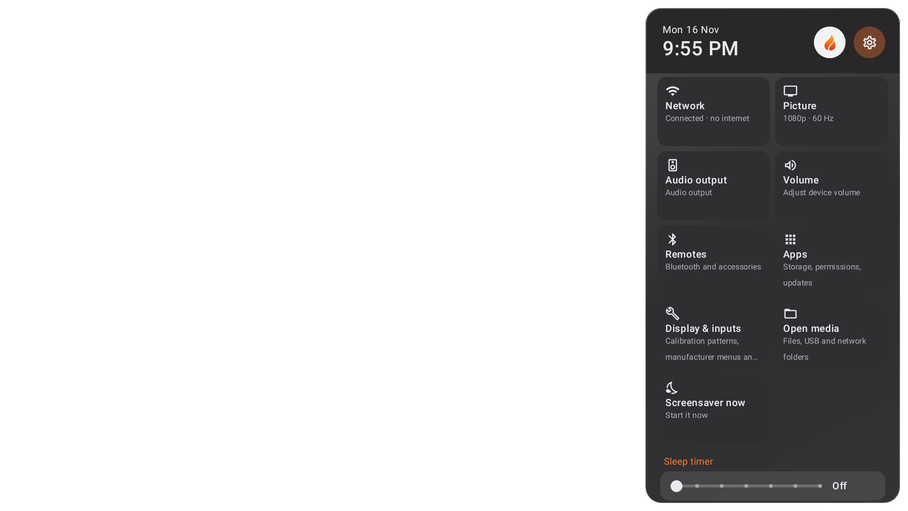 |

[Appearance settings](screenshots/appearance.png) let you change layouts, colours and presentation independently.

## Navigation choices

| Ember Collapsed | Cinema Bar |
| --- | --- |
| 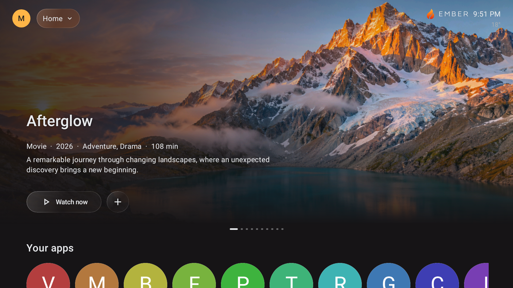 |  |

The default Ember navbar is shown in the Home capture above. These navbar choices
apply to Ember; Ember Light keeps its app-tile navigation.

[Appearance guide](appearance.md) · [All features](features.md) · [Back to Ember](../README.md)
